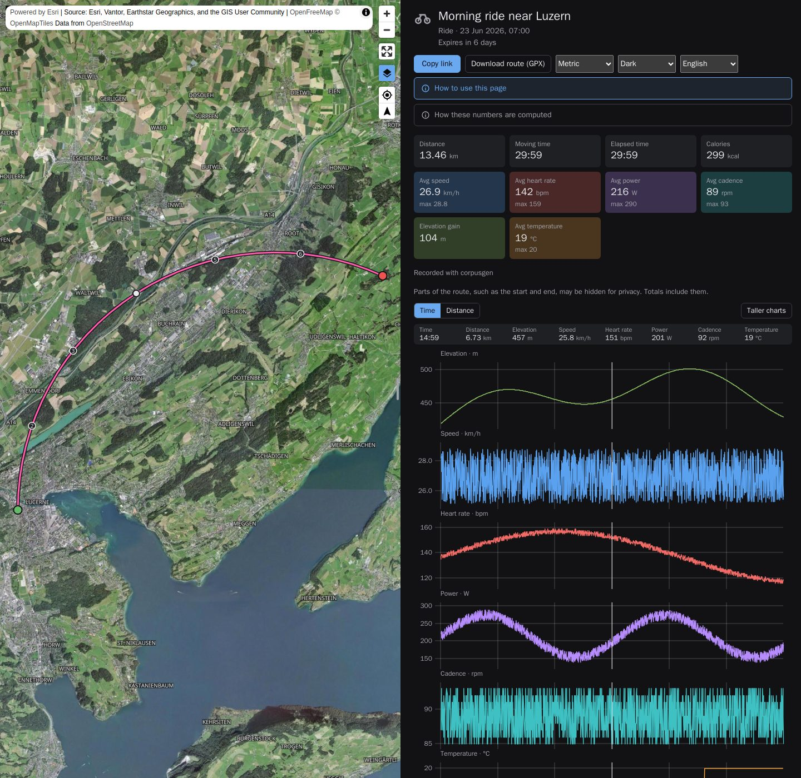
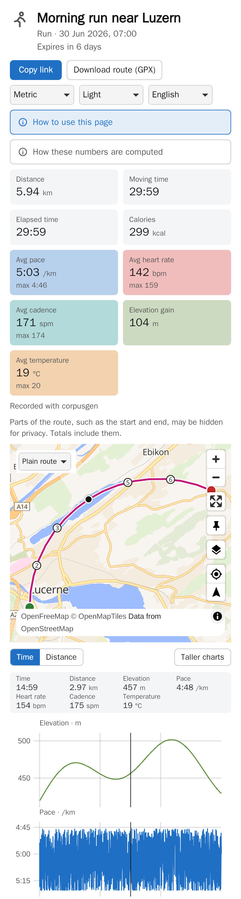
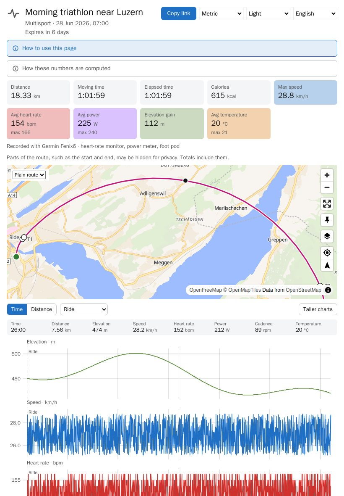

# Workout Explorer

A small, free viewer for FIT files: upload one, get a shareable activity page. Go server plus Svelte front end.

**Live demo:** https://workouts.plugman.de

| Ride, desktop, dark, satellite layer | Run, phone |
| --- | --- |
|  |  |



Screenshots show synthetic workouts; regenerate with `make screenshots` (needs Docker and internet for map tiles).

## Install

Releases are signed; see `deploy/RUNBOOK.md` for what every install shares, then the guide for your path: `deploy/DOCKER.md` (Docker Compose), `deploy/PODMAN.md` (rootless Podman) or `deploy/BAREMETAL.md` (systemd, no containers). The image is `ghcr.io/b0wter/workout-explorer`.

## Layout

Decided in `architect/ADR-001-repository-layout-and-build-entry-point.md`.

```
/
├── Makefile                        single build entry point for people and CI
├── build/                          all build output (git-ignored)
│   ├── workout-explorer            Go binary
│   └── web/                        Vite output
├── spec/  features/  architect/  qa/   specification, features, architecture, QA reports
└── src/
    ├── server/                     Go module `workout-explorer`
    │   ├── cmd/workout-explorer/   the binary: subcommands (serve, parse), flags, wiring
    │   ├── internal/httpapi/       HTTP adapter for /api/*
    │   ├── internal/ingest/        FIT decoding, the only user of github.com/muktihari/fit (ADR-003)
    │   ├── internal/workout/       normalised workout and its rules, pure
    │   ├── scripts/corpus.sh       `make corpus` driver
    │   ├── scripts/prototype-data.sh  `make prototype-data` driver
    │   ├── tools/corpusgen/        synthetic corpus generator (dev only, not in the binary)
    │   ├── tools/protoserve/       prototype static server with brotli (dev only, never deployed)
    │   └── testdata/corpus/        FIT corpus and golden reports (ADR-004)
    └── web/                        npm package: Svelte 5 + Vite + TypeScript app
        ├── index.html              entry of the prototype activity page (F-07)
        ├── scripts/                check-bundle-size.mjs (ADR-002)
        └── src/                    main.ts mounts prototype/ (the page); measure/ is the lazy scrub recorder (?measure); lib/ is pure TypeScript (no Svelte, no DOM)
```

## Prerequisites

- Go, version from the `go` and `toolchain` lines in `src/server/go.mod`
- Node, version from `src/web/.nvmrc`, with npm
- make

## Make targets

Run from the repo root. CI runs `make -k ci` and nothing else, only on `v*` tags and manual runs (not on branch pushes).

| Target | Does |
| --- | --- |
| `make deps` | Install dependencies (`npm ci`, `go mod download`) |
| `make lint` | `gofmt -l`, `go vet`, `svelte-check` |
| `make test` | Go tests and front-end tests |
| `make build` | Static Go binary to `build/workout-explorer`, bundle to `build/web/` |
| `make size` | Bundle size check against the 60,000-byte gzip budget (ADR-002) |
| `make ci` | `lint`, `test`, `build`, `size` |
| `make corpus` | Parse every corpus file and show `diff -u` against the golden reports (ADR-004) |
| `make corpus-update` | Rewrite the golden reports after an intended parser change; review the diff |
| `make corpus-gen` | Regenerate the synthetic corpus files (identical bytes on every run) |
| `make prototype-data` | Data files for the prototype page in `build/prototype/data/` (synthetic `ride-12h`, `ride-4h`; `REAL=<file.fit …>` adds local real files; never commit the output) |
| `make prototype-serve` | Serve the built page and the prototype data with brotli on `$(PROTO_ADDR)`, default `:18080`; `PROTO_FLAGS=-tls` for HTTPS (development only) |
| `make dev-server` | Run the server with `go run` on `$(DEV_ADDR)`, default `127.0.0.1:8080`; reads the page template from `build/web` (run `make build-web` first) |
| `make dev-web` | Run the Vite dev server, proxying `/api` to the Go server |
| `make clean` | Remove `build/` |

Each of `deps`, `lint`, `test` and `build` also has `-server` and `-web` variants (for example `make test-server`).

## Local development

In two terminals:

```
make dev-server
make dev-web
```

Then open the URL Vite prints. The placeholder page calls `/api/health` through the Vite proxy and shows `Server: ok (version dev)`, or `Server unreachable: <reason>` when the server is not running.

If `127.0.0.1:8080` is taken, pass the same `DEV_ADDR` to both targets:

```
make dev-server DEV_ADDR=127.0.0.1:18080
make dev-web DEV_ADDR=127.0.0.1:18080
```

or run `export DEV_ADDR=127.0.0.1:18080` once per shell.

## Design docs

- [`architect/INDEX.md`](architect/INDEX.md): all architecture docs and ADRs
- [`architect/F-01-project-skeleton-and-ci.md`](architect/F-01-project-skeleton-and-ci.md): server command, health contract, size check
- [`architect/F-02-fit-parsing-and-normalisation.md`](architect/F-02-fit-parsing-and-normalisation.md): FIT parsing, normalisation rules, corpus
- [`deploy/RUNBOOK.md`](deploy/RUNBOOK.md): what every install path shares (choosing a path, configuration, notifications, reverse proxy, privacy, the operator's deploy); [`deploy/DOCKER.md`](deploy/DOCKER.md): Docker Compose with the published image (also building the image yourself); [`deploy/PODMAN.md`](deploy/PODMAN.md): rootless Podman; [`deploy/BAREMETAL.md`](deploy/BAREMETAL.md): no containers
- [`spec/`](spec/): what the app does


## License

GNU Affero General Public License v3.0 only (AGPL-3.0-only); see [`LICENSE`](LICENSE).
